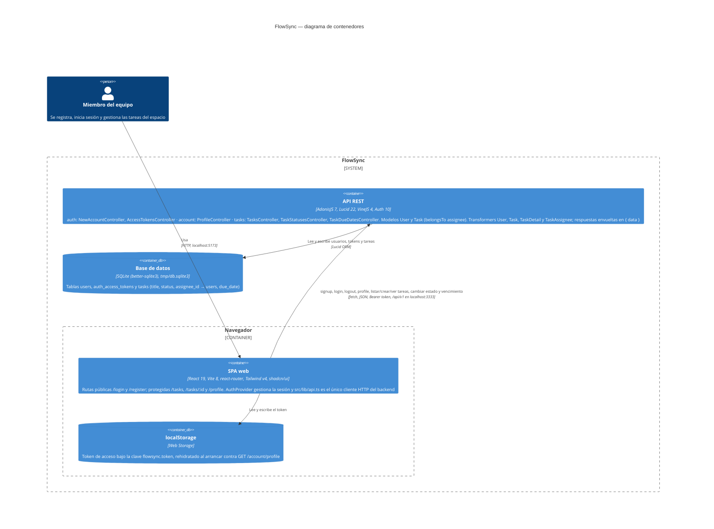

# Arquitectura de FlowSync

Diagrama de contenedores (nivel 2 de C4) de FlowSync tal y como está hoy en el código. Una persona del equipo usa la SPA de React (`frontend/`), que guarda el token de sesión en el `localStorage` del navegador y habla con la API AdonisJS (`backend/`) por HTTP/JSON bajo `/api/v1` y con `Authorization: Bearer`, siempre a través de `src/lib/api.ts`. La API autentica con access tokens opacos (guard `api`), valida con VineJS, da forma a las respuestas con transformers dentro del envoltorio `{ data }` y persiste con Lucid en un único fichero SQLite (`tmp/db.sqlite3`). Cada contenedor solo nombra controladores, modelos, transformers y tablas que existen en el repo.

